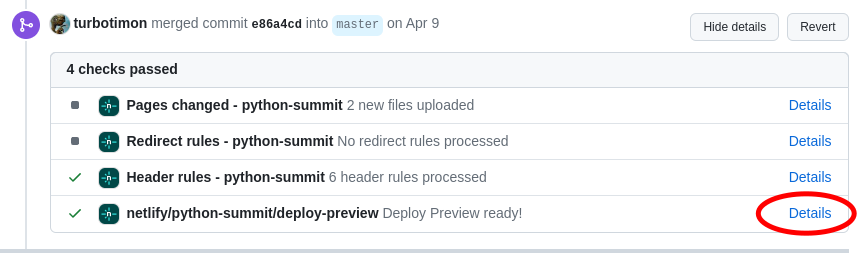

# Static Website for the Swiss Python Summit

See [www.python-summit.ch](https://www.python-summit.ch/)

## Development

### General

* This project is made with [Lektor](https://www.getlektor.com/). Lektor is a static content management and pages can be easy written in Markdown
* The design uses [Spectre](https://picturepan2.github.io/spectre/index.html) as its base. Spectre is a lightweight CSS framework with a lot of components you can use.

### Run website for local development

* Clone the repository or open in GitHub Codespace
* Install [uv](https://docs.astral.sh/uv/getting-started/installation/)
* Install dependencies with `make install` (or `uv sync --locked`)
* Run Lektor server with `make serve` for live preview of the website (on port 5000)

uv manages the `.venv` automatically and uses Python 3.10 from `.python-version`,
downloading it if needed. You do not need to create or activate a virtual environment.

* Build the website with `make build`; output goes to `build/`
* Check that the Lektor CLI works with `make test`
* Add dependencies with `uv add <package>` and update locked versions with `uv lock --upgrade`
* Commit both `pyproject.toml` and `uv.lock` when changing dependencies

Lektor manages the plugins listed in `sps20/sps20.lektorproject` separately.
Their versions are pinned there, but their transitive dependencies are not covered by `uv.lock`.

### Tips & Tricks

* To treat `*.lr` Lector files as Markdown in vscode, add these settings
  ```json
      "files.associations": {
        "*.lr": "markdown"
    }
  ```

### Branch and merge rules

Please follow these rules to keep the repo clean:

* Name branches with prefix `spsYY-` e.g. `sps24-open-cfp`
* Do so also for the pull request
* You can see a preview for reviews in a pull requests:


### Deployment

* The **main** branch is automatically live deployed with Netlify, so be careful what you push here!
* The `build.sh` is executed in the Netlify build process
* The build script installs uv if needed and builds using the committed lockfile
* Keep `.python-version` and Netlify's `runtime.txt` aligned when changing Python versions

### How to add a talk recording

#### Manually
- Go to http://localhost:5000/admin/root:recordings/edit
- Click "Add Page"
- Choose the "Recording" model
- Set the "Title" field to the talk title
- Click "Add Child Page"
- Fill in the data and save
- Click "Add Attachment"
- Upload PDF file with slides
- Click on the attachment in the left navigation
- Change the attachment type to "Slides"

Note: The playlist URLs are stored in `databags/playlists.json`.

#### Semi-Automatic from Pretalx JSON

- See Scripts in `scripts/recordings`
- These scripts will provide you with the folder structure.
- Thinks to do manually:
    - Add the youtube urls in the `contents.lr` files (per talk)
    - Add the playlist URLs in `databags/playlists.json`
    - Add the slides pdf and give it the same filename as the `<name>.pdf.lr` provided
